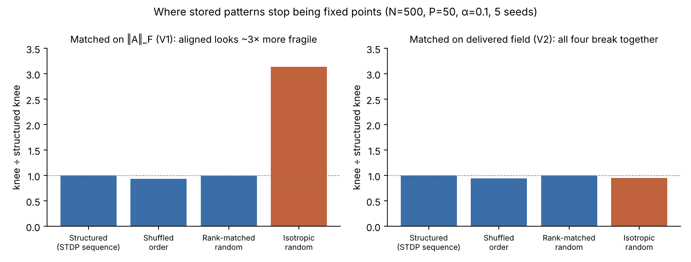

# How much antisymmetry can a Hopfield energy landscape survive? (probe O18)

One probe from **Boltzmann Brains**, my independent research program in computational and theoretical neuroscience. This repo is a self-contained extract: the pre-registered spec, the code, the raw results, and the write-up. The full write-up includes the record of how my first analysis was wrong.



## The question

Hopfield networks get their energy landscape from symmetric weights. Real synaptic plasticity (STDP) is temporally **antisymmetric**. Write the weights as `W = S + λA`, with `S` the Hebbian symmetric part and `A` antisymmetric. How large can `λ` get before stored patterns stop being fixed points? And is biologically *structured* antisymmetry (STDP applied to a stored sequence) worse than random antisymmetry?

## Design (pre-registered before any code: `docs/42_o18_antisymmetry_spec.md`)

- **Conditions:** structured (STDP on a pattern sequence), shuffled sequence order, a random operator confined to the pattern subspace, and isotropic random. N = 500, P = 50, five seeds, plus a load sweep over α = P/N.
- **Predictions with numbers:** the knee ratio should scale as √α (derived from the operators), plus a sequence-transition prediction and a load prediction, each with a stated falsifier.
- **Pre-flight checks** (`analysis/preflight.py`): dynamic range, control potency, empirical nulls and name/content checks, run before interpreting anything.

## Result (V2, after adversarial review: `notes/o18_antisymmetry.md`)

**Matched on the Frobenius norm, pattern-aligned antisymmetry breaks the landscape at about a third of the strength isotropic antisymmetry needs. That whole factor is a unit conversion:** an operator confined to the P-dimensional pattern subspace delivers √(N/P) times more field to the stored patterns. Matched on delivered field, all four conditions break at the same point, flat to ±3%. The biological structure contributes nothing beyond where the operator lives. The pre-registered √α turns out to be exactly the exponent of that unit conversion.

## What went wrong first

The first analysis (V1) concluded the opposite: structured antisymmetry was ~3× more corrosive, and √α was "decisively rejected." Review found, among other things:

- the swept parameter didn't mean the same thing across conditions (units, not landscape);
- one control (shuffled order) could not have failed, because shuffling exchangeable patterns is an exact re-draw;
- the sequence-transition metric measured the direction opposite to the one the dynamics actually pushes, and the arm was unreachable anyway;
- uncertainty was quoted ~10× too tight (leave-one-out over loads instead of over seeds);
- 7 of 9 deliberately broken versions of the code still passed all 13 tests.

Section 7 of the notes records each failure and the protocol change it produced. Those lessons are now standing rules in `docs/25_probe_protocol.md` and `docs/working_rules.md`.

## Repo layout

| Path | What it is |
|---|---|
| `docs/42_o18_antisymmetry_spec.md` | Pre-registered spec: question, prior-art scan, predictions, falsifiers, controls |
| `notes/o18_antisymmetry.md` | V2 write-up: verdicts, controls, power, failure record |
| `experiments/o18_antisymmetry/` | Harness, runs, analysis, review checks, tests |
| `experiments/p1_unlearning/hopfield.py` | Hopfield network shared with an earlier probe |
| `analysis/preflight.py` | Pre-flight checks used before interpreting any metric |
| `results/o18_antisymmetry/` | Raw per-cell JSONL results and V1 analysis output |
| `docs/25_probe_protocol.md`, `docs/working_rules.md` | The program's probe protocol and working rules |

**Known gaps, kept on purpose:** `results/` holds V1-era artifacts, `run_load.py` still has the superseded configuration, and nothing here regenerates `knee_law.json` (notes §7.6). Some docs reference other parts of the program that aren't in this extract. Mode was *intuition-build*: no novelty is claimed (notes §8).

## Run it

```bash
pip install numpy scipy pytest
python -m pytest -q experiments/o18_antisymmetry      # 13 tests
python experiments/o18_antisymmetry/run.py --help
python experiments/o18_antisymmetry/review_checks.py
```

Extracted from the private program repo at commit `9a89207`.
